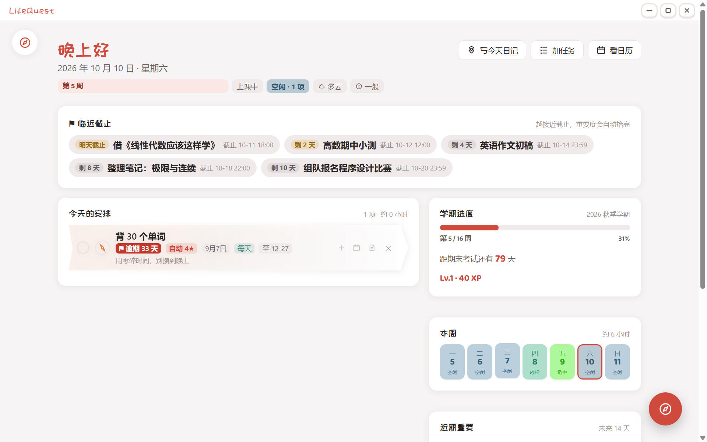
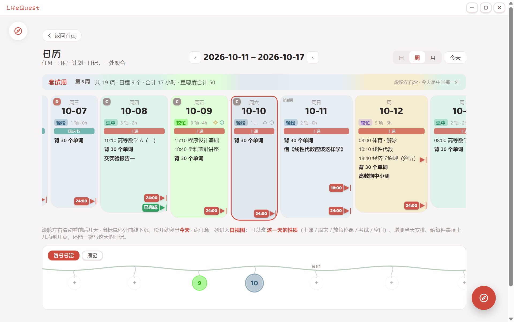
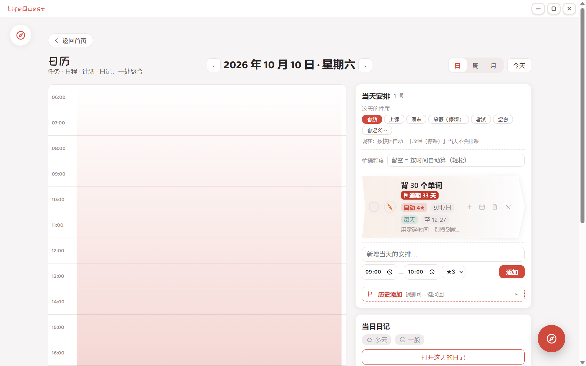
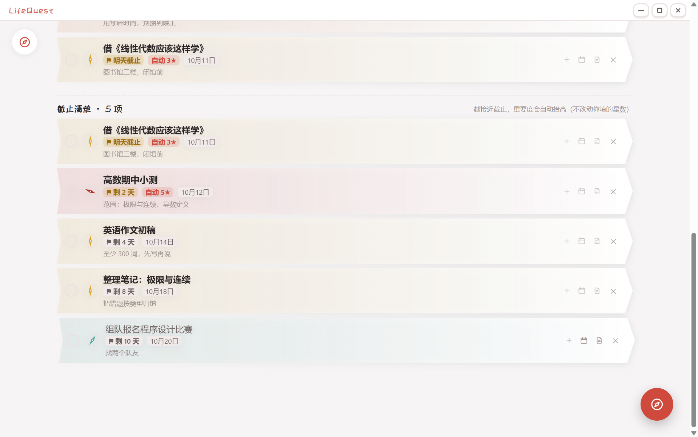
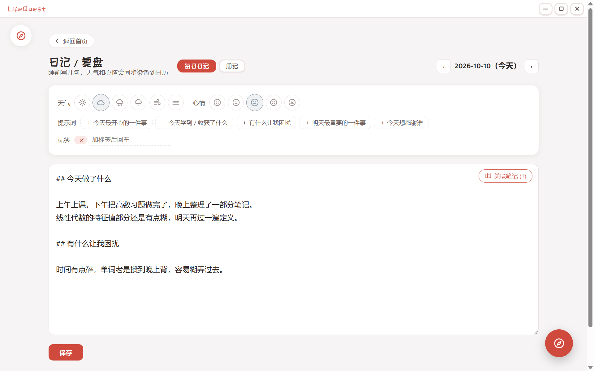
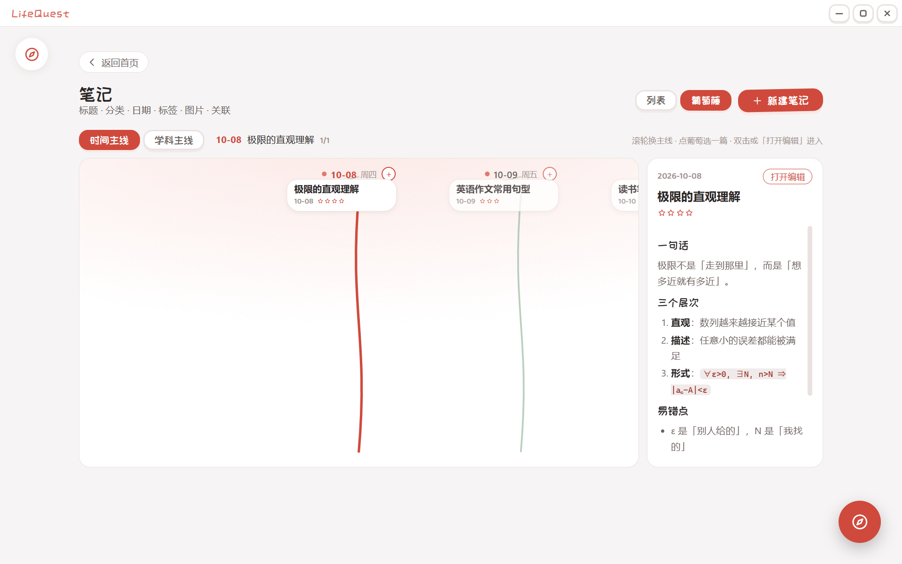
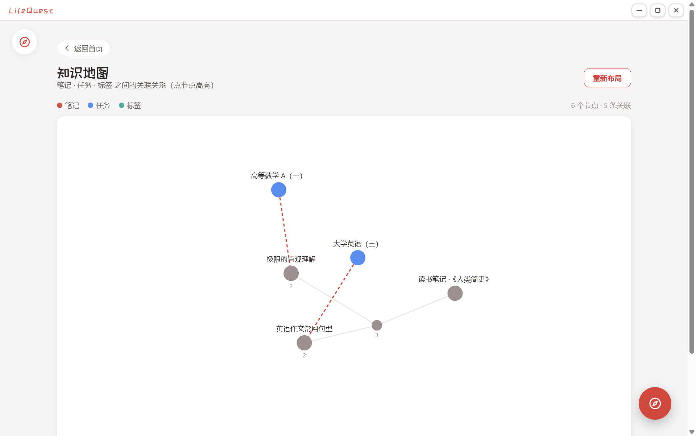

# LifeQuest · 把现实生活当成一场可以自己定规则的游戏

> 日记 / 日历 / 待办 / 笔记 / 活动计划，一处聚合。
> **本地优先**：所有数据都是你自己电脑上的普通 Markdown 和 JSON 文件，随时能打开、复制、备份、带走。
> **游戏化只是可选外壳**：没有排行榜，没有连续打卡惩罚，没有强制任务。

**🌐 产品主页（含截图与下载）：<https://duke-guo.github.io/LifeQuest/>**



---

## 这是给谁用的

给「想认真记录生活，但讨厌被工具 PUA」的人。

- 有课程表、有 deadline、想记日记和笔记，但不想在五六个 App 之间来回切
- 喜欢游戏化的反馈感（等级、成就、完成度），但反感打卡断签、每日强制任务、排行榜比较
- 在意数据归属：不想把日记存在别人的服务器上，也不想哪天服务关停就全没了

## 它不是什么

- 不是打卡类自律 App：**不制造焦虑**是硬性设计原则，失败没有惩罚
- 不是云笔记：默认不联网、不上传（唯一会联网的功能是「AI 识图导入」，用你自己的 API Key，可关闭）
- 不是团队协作工具：单人本地应用

---

## 功能一览

### 日历：一周是一条连续的时间带



- **一列一天，滚轮左右连贯滑动**（不是一页一周），进页面自动把今天放在屏幕正中
- 鼠标悬停时下边缘跟着鼠标平缓起伏；移开就重新突出**今天**
- 每天自动配色：**色相＝忙碌程度、饱和度＝心情、明度＝天气**，一眼看出这周哪几天重
- 一天的「性质」可手动指定：上课 / 周末 / 放假停课 / 考试 / 空白 / 自定义（比如"实习"）
- 忙碌程度可以手写覆盖算法默认值；过完的日子会按完成度给 **S / A / B / C / D** 评级
- 截止任务在日历上是一面**插在时间点上的小旗**，压在日程文字上时自动收成一个小旗

### 日视图：时间轴 + 截止压迫带



- 左时间轴 06:00–24:00，日程按时间块排；图上直接增删改、调重要度
- 截止型任务画成**一条横线 + 渐变**（越接近截止颜色越深）；和别的日程块重叠时只留一条线 + 文字

### 任务：主线 / 支线 / 每日，以及会自己冒头的 ddl



- 三类任务：**主线**（课程、长期目标）、**支线**（一次性事情）、**每日**（习惯）
- 重要度 1–5 星，卡片上的**罗盘指针**会跟着指向上方
- 重复：每天 / 工作日 / 每周 / 双周 / 每月；支持**重复链**（同一门课周二的时段和周四的时段写在一个任务里）
- 也支持**不规律日期**：一节一节地填具体日期
- 支线可以**拖到主线上**变成它的子任务，也可以一键摘下来；长列表拖拽有自动滚动
- **截止清单**：只有截止日期/时刻的任务（也就是 ddl）从今天起每天都会露头，越接近截止**显示的重要度自动抬高**（今天/逾期 +2★，三天内 +1★，只影响显示，不改你填的星数）
- 任务页同时露出「今天」和「明天」，不用翻日历

### 日记：每日日记与周记在同一页



- 顶部一键切换**每日日记 / 周记**，都存在同一个 `journal/` 目录里
- 天气与心情会**染色到日历**（就是上面那套"色相/饱和度/明度"）
- 有提示词（"今天最开心的一件事"…）可以点一下插进正文
- 正文右上角可以**关联笔记**（和"知识地图"共用同一套关联数据），点标题直接进那篇笔记
- 下面的**葡萄藤**一条藤串起所有日子：一天一颗果实，写过的果子有颜色；切成"周记"就是一周一颗，滚动速度是上面的 1/7

### 笔记：Markdown + 块级即时编辑



- 存成普通 `.md`（带 YAML front matter），别的编辑器也能打开
- **点哪写哪**：正文按段落分块，点一块就地变成输入框，Esc / Ctrl+Enter 提交，不用在"编辑/预览"之间切
- 支持 `- [ ]` 任务清单、代码块、图片（拖进来自动存到 `assets/`）
- 两种视图：**列表**（总列表 / 按时间 / 按内容）和**葡萄藤**（时间主线 / 学科主线，滚轮换主线、点葡萄选、双击进编辑）
- 自动保存（改完不用记得按保存）

### 计划、知识地图



- **学期计划**：校历起止、假期（放假当天自动停课）、考试周
- **活动计划**：给一段时间定一个主题（"期中复习周"），会铺到日历上
- **知识地图**：把笔记、任务、标签之间的关联画成一张网，关联越多的节点自动聚得越近

---

## 下载即用

**推荐从产品主页下载：<https://duke-guo.github.io/LifeQuest/>**（图文介绍 + 三平台按钮）。
也可以直接到 [Releases](../../releases) 页面挑对应系统的文件：

| 系统 | 文件 | 说明 |
|---|---|---|
| **Windows** | `LifeQuest-*-portable.exe` | 免安装，双击就能跑；数据落在 exe 同级的 `LifeQuest-Data/` |
| **macOS** | `LifeQuest-*-mac-x64.dmg` / `LifeQuest-*-mac-arm64.dmg` | Intel 芯片选 x64，Apple 芯片（M 系列）选 arm64；打开后拖进「应用程序」，数据在「文稿」目录下的 `LifeQuest-Data/` |
| **Linux** | `LifeQuest-*-linux-x86_64.AppImage` | `chmod +x` 后直接运行；数据落在 AppImage 同级的 `LifeQuest-Data/`。也有 `.deb` |

**首次运行的安全提示**（个人项目，没有购买代码签名证书，属于正常现象）：

- Windows：「未知发布者」→ 点「更多信息 → 仍要运行」
- macOS：右键 App → 「打开」；若提示"已损坏"，在终端执行 `xattr -cr /Applications/LifeQuest.app`
- Linux：个别发行版上 AppImage 会报沙箱错误，用 `./LifeQuest-*.AppImage --no-sandbox` 启动

想放到别处放数据？设环境变量 `LIFEQUEST_DATA_ROOT=/你的/目录` 即可，三个平台都支持。

## 从源码运行

需要 Node.js 20+ 和 npm（Windows / macOS / Linux 都可以）。

```bash
git clone https://github.com/Duke-guo/LifeQuest.git
cd LifeQuest
npm install
npm run dev        # 开发模式（热更新）
```

常用命令：

```bash
npm run typecheck  # TypeScript 检查
npm run build      # 编译到 out/
npm run dist       # 打包成当前平台的安装包（产物在 release/）
npm run release    # 打包 + （Windows）把便携版复制到 app/
```

> 想改应用图标：编辑 `scripts/make-icon.cjs` 里的 SVG，跑 `npx electron scripts/make-icon.cjs` 生成 `build/icon.png`（1024×1024），三个平台的图标都会由它生成。

## 数据存在哪 & 隐私

| 平台 | 默认位置 |
|---|---|
| Windows 便携版 | exe 同级的 `LifeQuest-Data/` |
| macOS | 「文稿」下的 `LifeQuest-Data/`（若 App 旁边已有同名文件夹则优先用它，方便绿色携带） |
| Linux AppImage | AppImage 文件同级的 `LifeQuest-Data/` |
| 开发模式 | 工程根目录的 `LifeQuest-Data/`（会向上层目录查找已有的同名文件夹） |
| 想自定义 | 设环境变量 `LIFEQUEST_DATA_ROOT=/某个目录`（三平台通用） |

目录结构（全是明文，随时可以手改）：

```
LifeQuest-Data/
├── config/     settings.json / semester.json / daynotes.json / links.json …
├── tasks/      tasks.json
├── journal/    2026-10-10.md（日记）、w2026-10-04.md（周记）
├── notes/      <uuid>.md（每篇笔记一个文件）
├── plans/      plans.json
├── assets/     笔记里插入的图片
└── archive/
```

**隐私**：程序默认完全离线，不会向任何服务器发送你的数据。唯一联网的功能是「AI 识图导入」（把图片发给你在设置里指定的模型服务），默认关闭。

⚠️ **注意**：AI 的 API Key 以明文存在 `LifeQuest-Data/config/settings.json` 里。分享数据文件夹或截图前记得清掉；这个目录也已经被 `.gitignore` 排除，不会被提交。

## 配置 AI 识图（可选）

设置 → AI → 填 `baseUrl` / `apiKey` / `model`（默认指向 DeepSeek，任何兼容 OpenAI 接口的服务都可以）。配好后可以把课表、通知、手写便签的图片丢进去，自动识别成任务。

## 操作小抄

| 位置 | 操作 |
|---|---|
| 日历（周） | 滚轮＝左右滑动 · 点一列＝进日视图 |
| 日历（月） | 滚轮＝翻月 · 点格子＝进日视图 |
| 笔记葡萄藤 | 滚轮＝换主线 · 点葡萄＝选中 · 双击＝进入编辑 |
| 日记葡萄藤 | 滚轮＝左右滑（和上面的日历同步）· 点果实＝进入日记 |
| 笔记正文 | 点段落＝就地编辑 · Esc/Ctrl+Enter＝提交 |
| 任务 | 拖动一条任务到另一条上＝挂成它的支线 |
| 任意位置 | 右下角罗盘＝导航 · 左上角头像＝导引与设置 |

## 项目结构

```
src/
├── main/        Electron 主进程：窗口、IPC、文件读写（dataStore.ts 负责数据目录与迁移）
├── preload/     contextBridge，暴露 window.api
├── renderer/    Vue 3 界面
│   └── src/
│       ├── views/       首页 / 任务 / 日历 / 笔记 / 日记 / 计划 / 赛季 / 知识地图
│       ├── components/  任务卡、葡萄藤、笔记块编辑器、确认弹窗、自绘标题栏…
│       ├── stores/      Pinia：tasks / journal / notes / links / semester…
│       └── utils/       日程展开、日期配色、日评级、Markdown 渲染、截止计算…
└── shared/      主进程与渲染进程共用的类型定义
docs/            设计文档与截图
```

技术栈：**Electron + Vue 3 + TypeScript + Vite（electron-vite）+ Pinia**，无数据库、无后端。

## 常见问题

**Q：有哪些平台版本？**
Windows（便携版 exe）、macOS（dmg，Intel 与 Apple 芯片）、Linux（AppImage / deb）都有，见 [Releases](../../releases)。三平台共用同一套代码，界面会按平台自适应（macOS 用系统红绿灯按钮，Windows / Linux 用自绘标题栏）。

**Q：macOS 上提示「已损坏」或「无法验证开发者」？**
个人项目没有购买 Apple 开发者证书（每年 99 美元），属于预期情况：右键 App → 打开；若仍被拦，执行 `xattr -cr /Applications/LifeQuest.app` 后再打开。

**Q：换电脑怎么搬？**
把整个 `LifeQuest-Data/` 文件夹拷过去放到对应位置即可，格式是纯文本，跨版本向上迁移。

**Q：会不会丢数据？**
所有写入都是先落到本地文件；但请自行定期备份（复制 `LifeQuest-Data/` 即可）。删任务可以在「历史添加」里一键找回。

**Q：能出手机版 / 网页版吗？**
短期内不会：这个应用的前提是"数据在自己电脑上的普通文件里"，做成云服务就违背了初衷。

## 参与贡献

见 [CONTRIBUTING.md](CONTRIBUTING.md)。Issue 和 PR 都欢迎，中文英文都可以。

## 协议与致谢

本项目使用 [MIT 协议](LICENSE)，可自由使用、修改、商用，保留版权声明即可。

第三方组件与字体的授权说明见 [THIRD-PARTY-NOTICES.md](THIRD-PARTY-NOTICES.md)。

---

## English (short)

**LifeQuest** is a local-first, gamification-optional life management desktop app (journal, calendar, todos, notes, plans) built with Electron + Vue 3 + TypeScript. All data lives in plain Markdown/JSON files on your own disk — no accounts, no cloud, no rankings, no streak shaming. Windows portable builds are on the [Releases](../../releases) page; run from source with `npm install && npm run dev`. Licensed under MIT.
